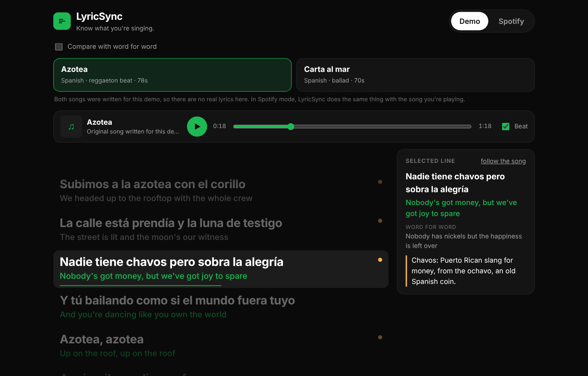

# LyricSync

**Know what you're singing.**

Real-time, line-by-line translations of the song you're playing on Spotify: synced to the music, written for meaning instead of word for word, with short notes on slang, cultural references and double meanings.

**[Try the live demo](https://tanhemdev.github.io/lyric-sync/)** (two demo songs with a built-in beat, no sign-in needed)

[](https://github.com/tanhemdev/lyric-sync/actions/workflows/ci.yml)
[](https://github.com/tanhemdev/lyric-sync/actions/workflows/pages.yml)

<p align="center"></p>

## Why I built this

An estimated 128.2 million people watched Bad Bunny's Super Bowl LX halftime show, the first one performed almost entirely in Spanish ([Nielsen, via Billboard](https://ca.billboard.com/music/music-news/bad-bunny-super-bowl-halftime-show-fourth-biggest-ever-1236177940)). Roc Nation put the views across platforms in the first 24 hours at 4.157 billion ([Consequence](https://concerts.consequence.net/articles/bad-bunny-super-bowl-halftime-show-views)).

I was watching with my friends, all of us screaming every word, and I couldn't stop wondering: how many of those people had no idea what he was saying?

Most of his listeners don't speak Spanish. They're in the car belting songs they can't translate, at concerts vibing on phonetics and energy. The music hits. The meaning doesn't. Word-for-word translation doesn't fix that either: it turns *pana* (buddy) into "corduroy" and *sin pena* (no holding back) into "without pain".

That night I started on LyricSync: translations that capture what the artist meant. Slang stays slang, and double meanings get explained instead of flattened.

## How it works

```
Spotify (what's playing, where you are in it)
   │  every 3 s, read-only
   ▼
LRCLIB (time-synced lyrics for that track)
   │  parsed into timed lines
   ▼
Claude, via /api/translate (meaning + optional note per unique line)
   │  cached in the browser per track and language
   ▼
Synced view: the current line, what it means, and a note when there's one worth reading
```

1. **Connect Spotify** (read-only: what you're currently playing).
2. **Play anything.** LyricSync finds the synced lyrics on [LRCLIB](https://lrclib.net), an open lyrics database.
3. **Read along.** Each line shows what it means, in time with the music. Lines with a dot have a note. Tap one to read it.
4. **Compare** with a word-for-word rendering to see what a literal translation would have lost.

The public demo runs the same pipeline on two songs written for this project (no real lyrics are stored in this repo), with a drum machine built from the Web Audio API so there's something to listen to.

## What's in the code

| Feature | Where |
|---|---|
| Synced lyric view: current line, progress bar, auto-scroll that pauses while you read ahead | `web/src/components/Lyrics.jsx` |
| LRC parser (multi-timestamp lines, offsets, word-level timing) | `web/src/lib/lrc.js` |
| Playback clock that smooths Spotify's polling: latency compensation, jitter filter | `web/src/lib/clock.js` |
| Spotify sign-in with PKCE (no client secret) and now-playing | `web/src/lib/spotify.js` |
| LRCLIB lookup with fallback search matched on track length | `web/src/lib/lrclib.js` |
| Translation client: choruses sent once, results cached per track | `web/src/lib/translate.js` |
| Translation function: prompt, input limits, CORS, robust JSON parsing | `api/translate.js`, `api/_lib/` |
| Context panel and word-for-word comparison | `web/src/components/NotePanel.jsx` |
| Demo songs and the Web Audio beat | `web/src/demo/songs.js`, `web/src/lib/beat.js` |

## Stack

| Layer | Tech | Why |
|---|---|---|
| App | React 19, bundled with esbuild | Re-renders every animation frame to keep the highlight on the beat |
| Playback | Spotify Web API, Authorization Code + PKCE | Runs entirely in the browser with no secret to leak |
| Lyrics | LRCLIB API | Free, open, time-synced lyrics fetched at play time |
| Translation | Claude API (Anthropic SDK) in a Vercel serverless function | Translates for meaning and tone, and keeps the API key on the server |
| Caching | Browser localStorage | A replayed song costs nothing and loads instantly |
| Hosting | GitHub Pages (demo), Vercel (full app + API) | |

No database: the app stores nothing about you, and the only thing it keeps is the translations, in your own browser.

## Run it

```bash
cd web
npm install
npm run build        # bundles to web/dist
npx http-server dist # or any static server, then open the printed address
npm test             # unit tests
npm run test:e2e     # browser tests (needs: npx playwright install chromium)
```

### Run Spotify mode

1. **Spotify app.** Create an app in the [Spotify Developer Dashboard](https://developer.spotify.com/dashboard), enable the Web API, and add your app's exact address as a redirect URI (for local testing, Spotify requires a loopback address like `http://127.0.0.1:8080/`, not `localhost`). Apps in development mode only work for Spotify accounts you add under *User Management*.
2. **Deploy to Vercel.** Import the repo; `vercel.json` builds the web app and serves `api/translate.js` next to it. Set:
   - `ANTHROPIC_API_KEY`: your Anthropic API key
   - `LYRICSYNC_SPOTIFY_CLIENT_ID`: the app's Client ID (public by design in PKCE)
   - `LYRICSYNC_TRANSLATE_URL`: `/api/translate`
   - optional `ANTHROPIC_MODEL` (default `claude-haiku-5-5`) and `ALLOWED_ORIGINS` if the web app lives on another domain
3. Open the site, choose **Spotify**, connect, and play a song.

For the GitHub Pages build, put the Client ID and the full URL of your Vercel `/api/translate` in `web/public/config.json`, and list `https://tanhemdev.github.io` in `ALLOWED_ORIGINS`.

## Tests

- **Unit (30 tests):** the LRC parser, the playback clock's latency and jitter handling, the PKCE challenge (checked against the example in RFC 7636), Spotify and LRCLIB response handling, chorus de-duplication and caching, and on the server: input limits, CORS, the prompt, and parsing replies that arrive wrapped in prose, out of order or incomplete.
- **Browser (Playwright):** the demo end to end (play, jump to a line, notes, word-for-word, keyboard, phone layout), and Spotify mode against stand-in Spotify, LRCLIB and translation servers: the sign-in callback, polling, synced lyrics, translations, and the cache on reload.

CI runs all of it and a production build on every push.

## Status

- v1.0 (October 2026): working app, live demo, tested pipeline.
- Spotify mode is built and tested against stand-ins, but not deployed publicly yet: it needs a Spotify app (development mode allows a small allowlist of users) and an Anthropic API key.
- Next: deploy Spotify mode for a small group of listeners, then measure what's in [docs/METRICS.md](docs/METRICS.md).

## Docs

[PRD](docs/PRD.md) · [User research](docs/USER_RESEARCH.md) · [Architecture](docs/ARCHITECTURE.md) · [Build log](docs/SPRINT_LOG.md) · [Metrics](docs/METRICS.md)

---

Built by [Tanya Hemdev](https://tanyahemdev.com), UC Berkeley. Because music shouldn't need a language requirement.
